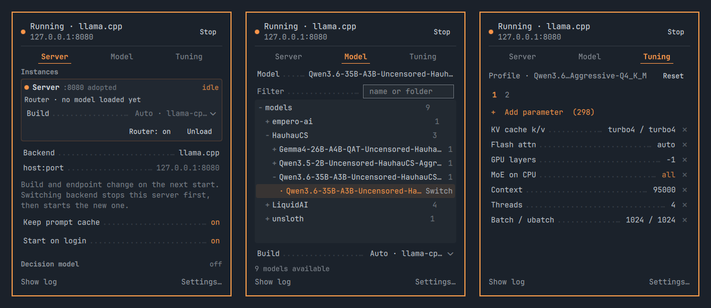
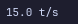

# Local AI Server

An Omarchy bar widget that starts, stops and monitors a local inference server —
**llama.cpp** (`llama-server`) or **ollama** — with live prompt and generation
throughput in the bar. One chat backend runs at a time; picking another one
while a server is running stops it first, then starts the new one as soon as it
has a model to launch. A **System One** decision model runs *alongside* it, on
its own port and its own build.

<a href="preview.png"></a>

In the bar it shows a server glyph while idle and the live rate while running —
 — or, while a
prompt is being read, how far along it is and how fast (`52% - 63 t/s`). A dot
on the glyph separates a stopped server from one that is up and idle. Click
opens the panel, right-click hides or shows the rate, and hovering opens a card
with the model, endpoint, build, both rates and a sparkline of recent
generation.

ollama embeds llama.cpp, so both backends log the same timing lines and one
parser handles both. ollama resolves the rates per completed request rather
than live, and exposes no prompt-progress sweep, so the widget reads the same
numbers at a lower resolution. Every other part of the page is identical.

## Install

```bash
omarchy plugin add https://github.com/SYJohnm/omarchy-local-ai-server.git --enable
```

That clones it into `~/.config/omarchy/plugins/io.github.syjohnm.local-ai-server/`,
checks the manifest and puts the widget on the bar. Move it with
`omarchy bar move io.github.syjohnm.local-ai-server --section right` (or `left`), and
update it with `omarchy plugin update io.github.syjohnm.local-ai-server`, which shows
the diff before applying.

On first open the panel runs a short **setup**: pick a backend, choose a models
folder, and start from tuning suggested for your hardware. Choices are saved to
this widget's settings in `shell.json`; run it again any time from **Re-run
setup** in Settings, or with
`qs -p /usr/share/omarchy/shell ipc call local-ai-server setup`.

## Remove

```bash
omarchy plugin remove io.github.syjohnm.local-ai-server
```

A server left running is not stopped by removing the widget — stop it from the
panel, or afterwards with
`systemctl --user stop io-github-syjohnm-local-ai-server-llamacpp` (or `-ollama`,
or `-sys1` for System One). Settings and prompt caches stay in
`~/.local/state/omarchy/io.github.syjohnm.local-ai-server/`; the caches can be several
GB, so delete that folder too if you are done with it.

## Requirements

| Needs | Notes |
|---|---|
| `llama-server` or `ollama` | The backend itself. Every build is detected; see below. |
| `bash`, `curl`, `python3`, `find` | Launch, health, model probing. |
| `bwrap` (recommended) | Sandboxes the `--version`/`--help` probe that identifies a build, so a binary you have not vouched for can be identified without being let loose. Shipped with **bubblewrap**, a dependency of flatpak. Without it, builds found by scanning are listed unidentified. |
| `systemd-run` (recommended) | Keeps the server a detached **systemd** user unit, which is what makes it survive `omarchy restart shell`. Without it the launch falls back to `setsid`. |
| `git`, `nvidia-smi` or `rocm-smi` | Optional: name builds after their checkout; VRAM-aware suggestions. |
| A Nerd Font | For the bar glyph and the panel's icons. Omarchy installs JetBrainsMono Nerd Font and the shell draws in it, so nothing to do. |

The server runs as your user and only listens on `127.0.0.1` unless you change
the host; the panel warns when the host is not loopback, because llama-server
has no API key.

**Privileges.** The widget never uses `sudo`. Servers are launched as your own
transient **systemd user** units (`systemd-run --user`), or with `setsid` where
there is no user session. The one privileged action is **Take over**, which
stops a distribution-managed `ollama.service` so the widget can run its own in
its place; that is a system unit, so `systemctl` raises a polkit prompt and you
authorise it. It happens only when you press that button.

**What it writes.** Its own settings and prompt caches under
`~/.local/state/omarchy/io.github.syjohnm.local-ai-server/`, and this widget's
own entry in `shell.json`. Nothing else in your configuration is touched — see
*Hooks* for wiring other tools to the running server.

## Settings

Everything auto-detects; the settings exist to override.

| Setting | Default | Meaning |
|---|---|---|
| `backend` | `llamacpp` | Which server to manage. Also switchable from the panel. |
| `binary` | auto | Preferred `llama-server`; wins whenever a model is on **Auto**. |
| `altBinary` | — | An extra `llama-server` build the scan would not find on its own. |
| `ollamaBinary` | auto | The `ollama` binary. |
| `modelsDir` | auto | Probes `~/models`, `~/.cache/llama.cpp`, `~/.local/share/models`, LM Studio and jan directories. |
| `systemoneBinary` | auto | Blank uses the preferred `llama-server`. |
| `systemoneModelsDir` | auto | Blank reuses the main model scan; set it to keep decision models apart. |

Selected model, tuning values, host and port are runtime state in
`~/.local/state/omarchy/io.github.syjohnm.local-ai-server/settings.json`.

## Models and builds

Many people run more than one `llama-server` (upstream, a fork, the package).
`llama_builds.py` finds them all — install paths, `PATH`, `build/bin/` under
`~`, release archives under `~/Downloads`, and `/opt`. A fork that names its
server `beellama-server` is accepted too. Each build is identified by remote,
commit, date and GPU backend, plus the flags its `--help` accepts.

### Identifying a build runs it

Nothing on disk carries a build's version or its KV cache types: `--version`
and `--help` are the only source, so identifying a build means executing it.
That is done inside a `bwrap` sandbox — uid 65534, all capabilities dropped,
no network, no environment, read-only system paths, its own PID namespace, and
nothing of `$HOME` but the build's own directory. So a build is safe to *look*
at before you know anything about it, which is the point: you cannot judge a
fork you cannot see.

**Trusting a build is a separate step, and it is the one the sandbox cannot do
for you.** A trusted build runs as your server for real — your files, your
models, the network, your account. The plugin holds back anything it found by
scanning and shows a `trust to use` tag with the reason; one click approves it.

Ownership and file mode are not evidence of intent here, which is why the
plugin does not treat them as such: extracting a downloaded archive makes you
the owner of every file in it, mode 0755 and all, and the archive picks its own
directory name and can ship its own `.git`. **A forged build therefore looks
exactly like a genuine one in the list.** Trust one because you know where it
came from — not because it appears, and not all of them out of habit. A build
whose file another account on the machine can rewrite is marked `blocked` and
cannot be trusted at all, since approval could not bind what runs later.

Without `bwrap` installed there is no safe way to identify an unvouched build,
so those are listed unidentified rather than run unconfined. Each build is identified by
remote, commit, date and GPU backend, plus the flags its `--help` accepts.
With more than one build the Model and Server pages show a **Build** picker;
**Auto** (the default) takes the first build that serves the model's tuning.
A configured fork path that no longer exists (or is not a runnable
llama-server) is listed as **missing** instead of being dropped silently.

The **Model** page follows the active backend: with System One selected it lists
and selects that backend's decision models (its own directory when
`systemoneModelsDir` is set), and the Tuning page stores their profile under the
model the server actually launches.

A folder that holds a projector (`mmproj`) or an external MTP draft (`...MTP...`)
beside its model is read as one package: neither file is offered as a model, and
both are picked up automatically when that model starts.

## Tuning

Tuning is per model: picking a model and changing anything creates a profile
for it; models without a profile run on the shared defaults. **Reset** drops a
profile, **Set default** makes the values on screen the seed for new models.
Profiles are keyed `backend::model`, since llama.cpp tuning is argv and ollama
tuning is environment. The Tuning page holds seven rows; a numbered tab carries
the rest, and adding a parameter opens the page that lands on.

| Row | Flag | Default |
|---|---|---|
| KV cache k / v | `--cache-type-k`, `--cache-type-v` | model's own |
| GPU layers | `--gpu-layers` | hardware suggestion |
| Flash attention | `--flash-attn` | on |
| MoE on CPU | `--cpu-moe`, `--no-repack` | off |
| Context | `--ctx-size` | hardware suggestion |
| Threads | `--threads`, `--threads-batch` | hardware suggestion |
| Batch / ubatch | `--batch-size`, `--ubatch-size` | hardware suggestion |

Optional rows, from the same **+ Add parameter** picker: slots (-np), reasoning
preserve, speculative decoding, vision projector, paste-args and environment.
Two of them show themselves: a model with a projector finds the Vision row on
the page, and an automatically-chosen draft model shows the Speculative row. A
flag the running build does not accept is dropped from the launch line and
marked **⚠ not in this build**.

`--reasoning-preserve`, `--jinja` and the other `--x, --no-x` pairs are
tri-state (`default` passes neither side); adding one from the picker offers
all three.

**Hardware suggestions** come from a probe of the machine (`hw_probe.sh`):
GPU layers, physical-thread count and a context sized to the memory that will
hold the KV cache. They are shown under the controls and applied only through
**Apply detected defaults**.

**Environment** is a list: the row opens a small editor with one row per
`NAME=value`. Values may contain spaces, quotes and backslashes; they are
stored quoted and parsed back on load, so an old space-separated string still
opens as separate rows. **Paste args** splits a whole command line into the
rows above and empties itself; an argument no flag claims stays in the field
and is still passed verbatim.

## Changing something while it runs

Model and tuning are launch flags, so applying a change restarts. Once the page
no longer matches what is running, **Stop becomes Restart** and the bar mark
gains a `•`. Restart waits for running requests (**Force** to cut them off),
saves the prompt cache, restarts, and restores it once the new server answers
`/health`. Clients see refused connections during the load and should retry.

## Prompt cache

With **Keep prompt cache** on (the default), every slot's KV cache is saved on
Stop, Restart, and 20 s after the server goes idle; it is restored at the next
start. Re-reading a long prompt is what a restart costs on a small GPU;
loading the weights is not. `slot_kv.py` does the saving through llama-server's
`/slots` API. A cache saved under different tuning is rejected by the server
and the start is simply cold.

Slot files contain the prompt's token ids, so they are private by default: the
cache directory is `0700`, saved files are `0600`, and detached launches run
under `umask 077`.

A slot is the size of a context, and the cache of a model you later delete or
move is not reclaimed by anything else, so the folder grows quietly. **Settings**
shows what the caches currently occupy, and offers to remove the orphaned ones —
those whose model file is no longer on disk. Opening Settings walks the model
folders (the main ones plus System One's, since both backends save slots) and
keeps every cache backed by a model found there, under both the current and the
pre-hash file name. The offer is withheld entirely when that walk finds no
models at all, so a folder that is missing or not yet mounted cannot present
every cache as orphaned, and the removal passes the named files only, never a
pattern.

## Start on login

**Start on login** on the Server page starts the server by itself a few seconds
after the shell comes up, so the endpoint is there without opening the panel. In
router mode that brings up the router, and every model in the preset is servable
straight away.

It is the widget that starts it, not a systemd unit of its own: the widget is
what resolves the build, renders the router preset from the current profiles and
owns the tuned argv, so a standalone unit would go stale the moment any of those
changed.

It fires once per shell session, so a manual **Stop** stays stopped. It waits
for the binary, the build list and the model to resolve first, and it checks the
systemd unit before launching — a server that is already up but still loading
its weights does not answer `/health` yet, and starting on that would sweep the
unit and throw away a load that was nearly finished.

If the models live on a disk that is mounted at boot, nothing special is needed:
`local-fs.target` is reached long before the shell starts. A models folder that
is still missing when this fires simply leaves the server stopped.

## Several servers at once

**Server instances** (plugin settings, default 1) is how many persistent
`llama-server` instances the widget manages. Each index gets its own transient
unit, its own port (`host:port` and the ports above it), its own model and its
own build, and the Server page lists them with per-row Start, Unload and
Restart. The bar shows one number for the whole widget: generation rates are
added up, since that is what the machine is producing, while a prompt being
read is a single event and the furthest-along one is reported instead.

A model already assigned to another index is not offered again — two servers on
one model would hold the weights twice and write the same prompt-cache files.

llama.cpp only, and a single instance in **router mode**, where one process
already answers for every model in `models.ini`. Extra instances also need a
systemd user session: the `setsid` fallback has no unit to adopt or watch, so
with several servers there would be no honest way to report their state.
Lowering the number stops the instances above it, including ones left running
by a previous session.

## Decision model alongside the chat model

A System One decision model answers typed queries (Laya, Julia-1, lev) on its
own endpoint, costs almost no VRAM, and is most useful while a chat model is
loaded. It used to be a third *backend*, so choosing it stopped the chat
server — backwards for what it is. It is a companion now: **Decision model**
on the Server page turns it on, and it runs whatever the chat side is doing,
router mode included.

**It picks its own llama.cpp build.** That is the point of it: decision models
and their endpoints need a current llama.cpp, which is exactly what someone
running an older optimised fork for chat does not have. The two servers are
separate processes with separate binaries, separate ports and separate tuning
profiles, so neither constrains the other.

Its port defaults to 8081 and is held back from the chat instances, so
`instanceCount` 2 gives the chat side 8080 and 8082 rather than colliding with
it. A settings file that had System One selected as its backend turns the
companion on and leaves chat on llama.cpp, which is what selecting it stood in
for.

## When something breaks

`qs -p /usr/share/omarchy/shell ipc call local-ai-server diagnose` returns one
JSON document with everything needed to work out why a server is not running,
so neither a person nor an agent has to guess:

- **ready** — the probes that gate a launch (settings loaded, settings
  readable, capabilities, builds, adoption, systemd, model count). A "nothing
  happens when I press Start" is usually one of these.
- **binaries** — every detected build with its fork, commit and GPU, the one
  the chat side resolved to, and the decision model's.
- **servers** — one entry per managed server: port, unit name, state, owner,
  model, build, last error, and the `journalctl` command that holds its output.
- **runningNow** — what is actually running, read from `/proc`, beside what the
  page *would* launch. A mismatch means the server was adopted rather than
  started from this configuration, which is easy to chase in the wrong
  direction otherwise.
- **ignoredFlags** — flags the resolved build does not describe, which is why a
  tuning row can look set and change nothing.
- **nextLaunchArgs** — the exact argv of the next start, so it can be run by
  hand.
- **events** — the last 40 lifecycle events (`started`, `adopted`, `gone`,
  `crash`) with timestamps, because `lastError` holds one string and the next
  event overwrites it.
- **log** — the last 40 lines the server wrote.

Crashes and disappearances are also written to the shell's own log, so they
land in `qs log` beside whatever else was happening.

**A crash loop is reported rather than hidden.** The transient unit carries
`Restart=on-failure`, which keeps a server alive across a transient fault — and
hid the opposite case: a model the build cannot load cycles active → failed →
active every few seconds, and `is-active` answers "active" every time it is
asked. That read as "starting…" for the full ten-minute timeout while systemd
restarted it twenty times. The restart count is watched now: two restarts above
the count at launch means it is looping, so the unit is stopped and the reason
is read out of its journal — for example `unknown model architecture: 'lfm3'`,
which is what an older fork says about a model only current llama.cpp knows.

## Knowing when a server has gone

A server that crashed, was OOM-killed, or was stopped from a terminal is
reported as gone rather than left showing its last reading. `/health` keeps
being polled after a start answers — slowly, as a liveness check rather than a
readiness one — and three missed polls in a row (one is not enough; a server
decoding on a loaded machine can be slower than the timeout) marks it stopped
with the last meaningful line from its log. The transient unit's own state is
watched as well, which is what catches a crash during model load, when nothing
has answered `/health` yet and nothing ever will.

The rate is released a few seconds after the last token, so **idle** means
idle: it used to be cleared only by a stop, which left the rate of a request
that finished an hour ago on the bar for as long as the server ran.

## Surviving `omarchy restart shell`

The server is launched detached as a transient systemd user unit with
`Restart=on-failure` (`io-github-syjohnm-local-ai-server-<backend>`), so
`quickshell kill` does not take it down. The next widget instance re-adopts
the running server after checking its health endpoint, and reads back prompt
processing from journald. Survive-restart is always on; stop the server from
the panel first if you want it gone.

## ollama as a system service

A root-owned `ollama.service` is detected and shown, but the widget cannot stop
it on its own — the header marks it **external** and Stop is disabled. **Take
over** stops the system service (polkit asks), starts an instance the widget
controls, and serves the same model store.

## Direct llama-server and prompt cache persistence

llama.cpp models are served directly by `llama-server` — there is no relay
process of this widget's own in front of it. Switching models or changing builds
automatically drains active `/slots`, saves prompt KV caches (`slot_kv.py save`),
replaces or restarts the systemd user unit with the target model and tuned argv,
and restores the prompt cache once the health endpoint responds.

## Router mode

The Server page has a **Router** toggle (llama.cpp only, and only while the
server is stopped). It is off by default, which is the single-model mode
described above: one model, named on the launch line, loaded at start.

Turned on, the widget launches `llama-server` with `--models-preset` instead of
`--model`. llama-server then serves *every* model in the preset natively and
loads or unloads them per request, so a client picks the model by name and the
widget never has to restart to switch. The preset INI is regenerated from the
current profiles by the launch script itself, so it always matches what the
Tuning page holds rather than whatever was saved last; the Model page follows
whichever model the router reports as loaded.

The trade-off is the prompt cache: slot save/restore is a single-model operation
and is **disabled while router mode is on**. Leave it off if restoring a long
prompt across restarts matters more than switching models without one.

## Scripting

```bash
qs -p /usr/share/omarchy/shell ipc call local-ai-server status   # JSON: running, model, build, pp/tg
qs -p /usr/share/omarchy/shell ipc call local-ai-server repair   # heal the relay unit/state
qs -p /usr/share/omarchy/shell ipc call local-ai-server start
qs -p /usr/share/omarchy/shell ipc call local-ai-server stop
qs -p /usr/share/omarchy/shell ipc call local-ai-server model /path/to/model.gguf
qs -p /usr/share/omarchy/shell ipc call local-ai-server restart  # apply changes; again to force
qs -p /usr/share/omarchy/shell ipc call local-ai-server page tuning
qs -p /usr/share/omarchy/shell ipc call local-ai-server setup    # run the setup again
```

## Hooks

When the server comes up and goes away the widget runs:

```bash
omarchy hook local-ai-server <started|stopped> '<json>'
```

which executes every script in `~/.config/omarchy/hooks/local-ai-server.d/`.
The description it passes contains the backend, endpoint, context size, the
model being served and every model found in that store (with `thinking`,
`tools`, `vision` flags):

```json
{
  "event": "started",
  "backend": "llamacpp",
  "endpoint": "http://127.0.0.1:8080",
  "openaiBaseUrl": "http://127.0.0.1:8080/v1",
  "contextSize": 32768,
  "model": "/home/you/models/qwen3-8b-q4_k_m.gguf",
  "build": "llama.cpp · 662a0b0 · 2026-08-31 · CUDA",
  "models": [
    { "id": "/home/you/models/qwen3-8b-q4_k_m.gguf", "name": "qwen3-8b-q4_k_m",
      "thinking": true, "tools": true, "vision": false, "contextLength": 40960 }
  ]
}
```

`contextSize` is what the server was launched with (0: the model's own
`contextLength`). System One fires the same hooks with `backend: "systemone"`
on port 8081.

## Development

```bash
node --test tests/*.test.js
```

The suite needs `python3` (it drives `slot_kv.py` end to end against
`tests/fixtures/fake_backend.py`). Pure logic lives in `Model.js`,
`Backends.js`, `Hardware.js` and `Profiles.js`, all Node-testable with no QML
dependency; `Panel.qml` holds the UI and process orchestration.

Saving a file under `~/.config/omarchy/plugins/` reloads the plugin, but a
widget already on the bar is not always rebuilt — run `omarchy restart shell`
to be sure you are looking at the new code.

## License

[MIT](LICENSE).
