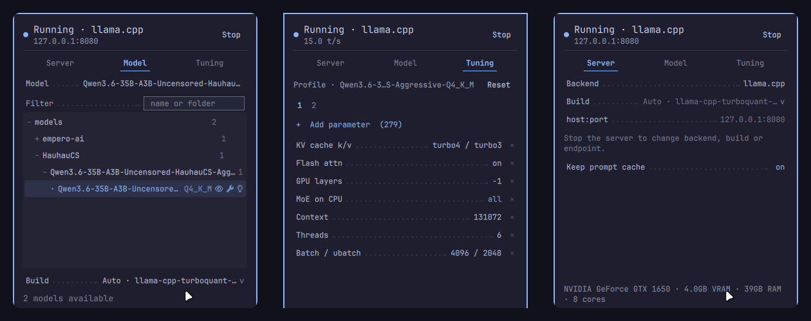
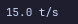

# Local AI Server

An Omarchy bar widget that starts, stops and monitors a local inference server —
**llama.cpp** (`llama-server`) or **ollama** — with live prompt and generation
throughput in the bar. A third **System One** backend serves decision models on
a separate port (8081 by default). One backend runs at a time; the picker is
disabled while the server is running, so stop it before switching.

<a href="preview.png"></a>

In the bar it shows the mark while idle and the live rate while running —
 — or, while a
prompt is being read, how far along it is and how fast (`52% - 63 t/s`).
Right-click to hide or show the rate again.

ollama embeds llama.cpp, so both backends log the same timing lines and one
parser handles both. ollama resolves the rates per completed request rather
than live, and exposes no prompt-progress sweep, so the widget reads the same
numbers at a lower resolution. Every other part of the page is identical.

## Install

```bash
omarchy plugin add https://github.com/SYJohnm/omarchy-local-ai-server.git --enable
```

That clones it into `~/.config/omarchy/plugins/io.github.syjohnm.local-ai-server/`,
checks the manifest and puts the widget on the bar. Move it with
`omarchy bar move io.github.syjohnm.local-ai-server --section right` (or `left`), and
update it with `omarchy plugin update io.github.syjohnm.local-ai-server`, which shows
the diff before applying.

On first open the panel runs a short **setup**: pick a backend, choose a models
folder, and start from tuning suggested for your hardware. Choices are saved to
this widget's settings in `shell.json`; run it again any time with
`qs -p /usr/share/omarchy/shell ipc call local-ai-server setup`.

## Remove

```bash
omarchy plugin remove io.github.syjohnm.local-ai-server
```

A server left running is not stopped by removing the widget — stop it from the
panel, or afterwards with
`systemctl --user stop io-github-syjohnm-local-ai-server-llamacpp` (or `-ollama`,
or `-sys1` for System One). Settings and prompt caches stay in
`~/.local/state/omarchy/io.github.syjohnm.local-ai-server/`; the caches can be several
GB, so delete that folder too if you are done with it.

## Requirements

| Needs | Notes |
|---|---|
| `llama-server` or `ollama` | The backend itself. Every build is detected; see below. |
| `bash`, `curl`, `python3`, `find` | Launch, health, model probing. |
| `systemd-run` (recommended) | Keeps the server a detached **systemd** user unit, which is what makes it survive `omarchy restart shell`. Without it the launch falls back to `setsid`. |
| `git`, `nvidia-smi` or `rocm-smi` | Optional: name builds after their checkout; VRAM-aware suggestions. |

The server runs as your user and only listens on `127.0.0.1` unless you change
the host; the panel warns when the host is not loopback, because llama-server
has no API key. Nothing else in your configuration is written to — see
*Hooks* for wiring other tools to it.

## Settings

Everything auto-detects; the settings exist to override.

| Setting | Default | Meaning |
|---|---|---|
| `backend` | `llamacpp` | Which server to manage. Also switchable from the panel. |
| `binary` | auto | Preferred `llama-server`; wins whenever a model is on **Auto**. |
| `altBinary` | — | An extra `llama-server` build the scan would not find on its own. |
| `ollamaBinary` | auto | The `ollama` binary. |
| `modelsDir` | auto | Probes `~/models`, `~/.cache/llama.cpp`, `~/.local/share/models`, LM Studio and jan directories. |
| `systemoneBinary` | auto | Blank uses the preferred `llama-server`. |
| `systemoneModelsDir` | auto | Blank reuses the main model scan; set it to keep decision models apart. |

Selected model, tuning values, host and port are runtime state in
`~/.local/state/omarchy/io.github.syjohnm.local-ai-server/settings.json`.

## Models and builds

Many people run more than one `llama-server` (upstream, a fork, the package).
`llama_builds.py` finds them all — install paths, `PATH`, and checkouts with a
`build/bin/` under `~` — and identifies each by remote, commit, date and GPU
backend, plus the flags its `--help` accepts. With more than one build the
Model and Server pages show a **Build** picker; **Auto** (the default) takes
the first build that serves the model's tuning.

The **Model** page follows the active backend: with System One selected it lists
and selects that backend's decision models (its own directory when
`systemoneModelsDir` is set), and the Tuning page stores their profile under the
model the server actually launches.

## Tuning

Tuning is per model: picking a model and changing anything creates a profile
for it; models without a profile run on the shared defaults. **Reset** drops a
profile, **Set default** makes the values on screen the seed for new models.
Profiles are keyed `backend::model`, since llama.cpp tuning is argv and ollama
tuning is environment. The Tuning page holds seven rows; a numbered tab carries
the rest, and adding a parameter opens the page that lands on.

| Row | Flag | Default |
|---|---|---|
| KV cache k / v | `--cache-type-k`, `--cache-type-v` | model's own |
| GPU layers | `--gpu-layers` | hardware suggestion |
| Flash attention | `--flash-attn` | on |
| MoE on CPU | `--cpu-moe`, `--no-repack` | off |
| Context | `--ctx-size` | hardware suggestion |
| Threads | `--threads`, `--threads-batch` | hardware suggestion |
| Batch / ubatch | `--batch-size`, `--ubatch-size` | hardware suggestion |

Optional rows, from the same **+ Add parameter** picker: slots (-np), reasoning
preserve, speculative decoding, vision projector, paste-args and environment.
Two of them show themselves: a model with a projector finds the Vision row on
the page, and an automatically-chosen draft model shows the Speculative row. A
flag the running build does not accept is dropped from the launch line and
marked **⚠ not in this build**.

`--reasoning-preserve`, `--jinja` and the other `--x, --no-x` pairs are
tri-state (`default` passes neither side); adding one from the picker offers
all three.

**Hardware suggestions** come from a probe of the machine (`hw_probe.sh`):
GPU layers, physical-thread count and a context sized to the memory that will
hold the KV cache. They are shown under the controls and applied only through
**Apply detected defaults**.

**Environment** is a list: the row opens a small editor with one row per
`NAME=value`. Values may contain spaces, quotes and backslashes; they are
stored quoted and parsed back on load, so an old space-separated string still
opens as separate rows. **Paste args** splits a whole command line into the
rows above and empties itself; an argument no flag claims stays in the field
and is still passed verbatim.

## Changing something while it runs

Model and tuning are launch flags, so applying a change restarts. Once the page
no longer matches what is running, **Stop becomes Restart** and the bar mark
gains a `•`. Restart waits for running requests (**Force** to cut them off),
saves the prompt cache, restarts, and restores it once the new server answers
`/health`. Clients see refused connections during the load and should retry.

## Prompt cache

With **Keep prompt cache** on (the default), every slot's KV cache is saved on
Stop, Restart, and 20 s after the server goes idle; it is restored at the next
start. Re-reading a long prompt is what a restart costs on a small GPU;
loading the weights is not. `slot_kv.py` does the saving through llama-server's
`/slots` API. A cache saved under different tuning is rejected by the server
and the start is simply cold.

## Surviving `omarchy restart shell`

The server is launched detached as a transient systemd user unit
(`io-github-syjohnm-local-ai-server-<backend>`), so `quickshell kill` does not
take it down. The next widget instance re-adopts the running server after
checking its health endpoint, which is also where it reads back prompt
processing from journald. Survive-restart is always on; stop the server from
the panel first if you want it gone.

## ollama as a system service

A root-owned `ollama.service` is detected and shown, but the widget cannot stop
it on its own — the header marks it **external** and Stop is disabled. **Take
over** stops the system service (polkit asks), starts an instance the widget
controls, and serves the same model store.

## Scripting

```bash
qs -p /usr/share/omarchy/shell ipc call local-ai-server status   # JSON: running, model, build, pp/tg
qs -p /usr/share/omarchy/shell ipc call local-ai-server start
qs -p /usr/share/omarchy/shell ipc call local-ai-server stop
qs -p /usr/share/omarchy/shell ipc call local-ai-server model /path/to/model.gguf
qs -p /usr/share/omarchy/shell ipc call local-ai-server restart  # apply changes; again to force
qs -p /usr/share/omarchy/shell ipc call local-ai-server page tuning
qs -p /usr/share/omarchy/shell ipc call local-ai-server setup    # run the setup again
```

## Hooks

When the server comes up and goes away the widget runs:

```bash
omarchy hook local-ai-server <started|stopped> '<json>'
```

which executes every script in `~/.config/omarchy/hooks/local-ai-server.d/`.
The description it passes contains the backend, endpoint, context size, the
model being served and every model found in that store (with `thinking`,
`tools`, `vision` flags):

```json
{
  "event": "started",
  "backend": "llamacpp",
  "endpoint": "http://127.0.0.1:8080",
  "openaiBaseUrl": "http://127.0.0.1:8080/v1",
  "contextSize": 32768,
  "model": "/home/you/models/qwen3-8b-q4_k_m.gguf",
  "build": "llama.cpp · 662a0b0 · 2026-08-31 · CUDA",
  "models": [
    { "id": "/home/you/models/qwen3-8b-q4_k_m.gguf", "name": "qwen3-8b-q4_k_m",
      "thinking": true, "tools": true, "vision": false, "contextLength": 40960 }
  ]
}
```

`contextSize` is what the server was launched with (0: the model's own
`contextLength`). System One fires the same hooks with `backend: "systemone"`
on port 8081.

## Development

```bash
node --test tests/*.test.js
```

The suite needs `python3` (it drives `slot_kv.py` end to end against
`tests/fixtures/fake_backend.py`). Pure logic lives in `Model.js`,
`Backends.js`, `Hardware.js` and `Profiles.js`, all Node-testable with no QML
dependency; `Panel.qml` holds the UI and process orchestration.

Saving a file under `~/.config/omarchy/plugins/` reloads the plugin, but a
widget already on the bar is not always rebuilt — run `omarchy restart shell`
to be sure you are looking at the new code.

## License

[MIT](LICENSE).
